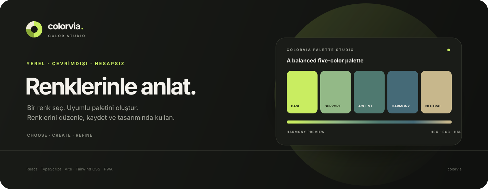
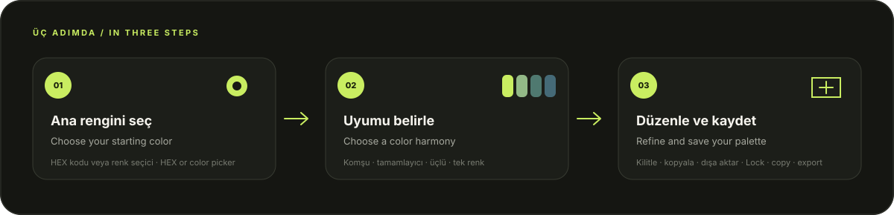

<div align="center">
  

  <p><strong>Renk seç. Uyum oluştur. Fikrini renklendir.</strong><br />Choose a color. Find harmony. Bring your idea to life.</p>

  <p>
    
    
    
    
    
  </p>

  <p><a href="#türkçe">Türkçe</a> · <a href="#english">English</a></p>
</div>

---

## Türkçe

**Colorvia**, uyumlu renk paletleri oluşturup düzenlemeyi kolaylaştıran, çevrimdışı çalışabilen bir web uygulamasıdır. Hesap açmadan kullanılır; paletler sunucuya gönderilmez, bu tarayıcıdaki cihaz depolamasında kalır. Site, desteklenen telefon ve bilgisayarlara **PWA olarak ana ekrana kurulabilir**.

### Ürün akışı

<p align="center"></p>

### Öne çıkanlar

- **Palet üretimi:** Ana rengi seç, komşu, tamamlayıcı, üçlü veya tek renk uyumuyla beş renkli palet oluştur.
- **Renk düzenleme:** HEX kodu yaz veya renk seçiciyi kullan; renkleri kilitle, yeniden sırala ve HEX değerlerini kopyala.
- **Renk bilgisi:** HEX, RGB, HSL değerlerini ve siyah/beyaz metin için WCAG kontrast önerisini görüntüle.
- **Yerel palet kitaplığı:** Paletleri kaydet, ada göre ara, tarihe veya ada göre sırala, tekrar düzenlemek için stüdyoya yükle.
- **Yedekleme:** Tek paleti dışa aktar veya tüm kitaplığı JSON olarak yedekle. Geri yüklemede birleştir, yinelenenleri atla ya da tümünü değiştir.
- **Kişisel görünüm:** Koyu/açık tema ve Türkçe/İngilizce arayüz arasında geçiş yap.
- **Kurulabilir ve çevrimdışı:** İlk çevrimiçi ziyaretin ardından uygulama kabuğu önbellekten açılır; PWA güncellemeleri kullanıcıya sorulur.

### Hızlı başlangıç

**Gereksinimler:** Node.js `22.6+` ve npm.

```bash
git clone https://github.com/ardairmk55/Colorvia.git
cd Colorvia
npm ci
npm run dev
```

Vite’ın gösterdiği yerel adresi tarayıcıda aç. Üretim sürümünü oluşturmak ve yerelde görüntülemek için:

```bash
npm run build
npm run preview
```

### Telefona uygulama gibi ekleme

Colorvia’yı telefonda kurmak için önce HTTPS üzerinden yayınlanan site adresini aç. Bilgisayardaki `localhost` adresi telefonda çalışmaz.

- **iPhone/iPad:** Safari’de siteyi aç → **Paylaş** → **Ana Ekrana Ekle** → **Ekle**.
- **Android:** Chrome’da siteyi aç → **⋮** → **Uygulamayı yükle** veya **Ana ekrana ekle** → onayla.

Kurulum, mağazadan indirilen yerel APK/IPA değil, bağımsız pencere ve ana ekran simgesiyle açılan bir **PWA** kurulumudur. HTTPS ve tarayıcı desteği gerekir.

### Veri, çevrimdışı kullanım ve yedekler

- Paletler IndexedDB’de, tema ve dil tercihleri `localStorage`’da saklanır. Hesap, backend, bulut yedeği veya cihazlar arası eşitleme yoktur.
- Tarayıcı verilerini silmek kayıtlı paletleri kaldırabilir. Önemli paletlerin JSON yedeğini düzenli olarak dışa aktar.
- Tekil palet ve toplu yedek içe aktarmaları en fazla **2 MB** olabilir. Toplu yedek `colorvia-backup` biçim sürüm 1’i ve en fazla **500 paleti** destekler. Kitaplığın toplam sınırı da 500 palettir.
- Çevrimdışı kullanım için ilk ziyaret ve servis çalışanı kurulumu çevrimiçiyken tamamlanmalıdır. Sonrasında önbelleğe alınmış uygulama kabuğu ve renk araçları çalışır.
- Depolama göstergesi yalnızca Colorvia’yı değil, aynı site adresindeki tarayıcı kullanımını raporlayabilir.

### Klavye kısayolları

| Kısayol | İşlem |
| --- | --- |
| `Ctrl/⌘ + G` | Yeni palet oluştur |
| `Ctrl/⌘ + S` | Paleti kaydet |
| `?` | Kullanım rehberini aç |

### Geliştirme kontrolleri

```bash
npm run lint
npm test
npm run typecheck
npm run build
```

GitHub Actions bu kontrolleri `main` dalına gönderimlerde ve pull request’lerde otomatik çalıştırır. Tarayıcılar arası IndexedDB, PWA kurulum akışı ve gerçek telefon ekranları ayrıca elle doğrulanmalıdır.

### Proje yapısı

```text
src/
├── App.tsx                     # Sayfa akışı ve arayüz
├── i18n/copy.ts                # Türkçe ve İngilizce metinler
├── services/color-engine/      # HEX, uyum üretimi ve renk ölçümleri
└── services/storage/           # IndexedDB, tercihler, yedekler ve sınırlar
public/                         # PWA, iOS ve tarayıcı simgeleri
docs/                           # README görselleri
.github/workflows/ci.yml        # GitHub Actions kalite kontrolleri
```

### Yayınlama notu

GitHub Actions yalnızca kodu doğrular; siteyi yayınlamaz. GitHub Pages proje adresleri bir alt dizinde çalıştığı için Vite `base` yolu ve PWA varlık yolları yayın adresine göre ayrıca ayarlanmalıdır. HTTPS destekleyen bir statik barındırma da kullanılabilir.

---

## English

**Colorvia** is an offline-capable web app for creating and refining harmonious color palettes. It needs no account: palettes stay in this browser’s local storage and are never sent to an application server. Install it on supported phones and computers as a **Progressive Web App (PWA)**.

### How it works

<p align="center"></p>

### Features

- **Generate palettes:** Choose a base color and create a five-color palette with analogous, complementary, triadic, or monochromatic harmony.
- **Refine colors:** Enter HEX values or use the color picker; lock and reorder swatches, then copy HEX codes.
- **Inspect color values:** View HEX, RGB, HSL, and WCAG contrast guidance for black or white text.
- **Keep a local library:** Save palettes, search by name, sort by date or name, and load a saved palette back into the studio.
- **Back up and restore:** Export an individual palette or the full library as JSON. Restore by merging, skipping duplicates, or replacing the library.
- **Make it yours:** Switch between dark/light themes and Turkish/English.
- **Install and work offline:** After the first online visit, the app shell can load from cache. Updates wait for your approval.

### Quick start

**Requirements:** Node.js `22.6+` and npm.

```bash
git clone https://github.com/ardairmk55/Colorvia.git
cd Colorvia
npm ci
npm run dev
```

Open the local URL printed by Vite. To build and preview the production app:

```bash
npm run build
npm run preview
```

### Add Colorvia to your phone

Open the deployed site over HTTPS on your phone. A computer’s `localhost` address is not accessible as `localhost` from another device.

- **iPhone/iPad:** Open the site in Safari → **Share** → **Add to Home Screen** → **Add**.
- **Android:** Open the site in Chrome → **⋮** → **Install app** or **Add to Home screen** → confirm.

This installs a **PWA** with its own app window and home-screen icon; it is not a store-distributed native APK/IPA. HTTPS and browser support are required.

### Data, offline use, and backups

- Palettes are stored in IndexedDB; theme and language preferences use `localStorage`. There is no account, backend, cloud backup, or cross-device sync.
- Clearing browser data can remove saved palettes. Export JSON backups regularly for anything important.
- Individual palette imports and full backups are limited to **2 MB**. Full backups must use `colorvia-backup` format version 1 and contain no more than **500 palettes**. The library limit is also 500 palettes.
- The first visit and service-worker installation need an internet connection. After caching, the app shell and bundled color tools work offline.
- The storage indicator may include browser usage for the entire site origin, not only Colorvia.

### Keyboard shortcuts

| Shortcut | Action |
| --- | --- |
| `Ctrl/⌘ + G` | Generate a palette |
| `Ctrl/⌘ + S` | Save the palette |
| `?` | Open the quick-start guide |

### Quality checks

```bash
npm run lint
npm test
npm run typecheck
npm run build
```

GitHub Actions runs these checks on pushes and pull requests targeting `main`. IndexedDB behavior across browsers, PWA installation, and real-device layouts still need hands-on browser testing.

### Project structure

```text
src/
├── App.tsx                     # App flow and UI
├── i18n/copy.ts                # Turkish and English interface copy
├── services/color-engine/      # HEX, harmony generation, and color metrics
└── services/storage/           # IndexedDB, preferences, backups, and limits
public/                         # PWA, iOS, and browser icons
docs/                           # README visuals
.github/workflows/ci.yml        # GitHub Actions quality checks
```

### Deployment note

GitHub Actions validates the code but does not deploy the site. GitHub Pages project sites are served from a subpath, so the Vite `base` path and PWA asset paths must be configured for the deployment URL. Any HTTPS static host can be used instead.

---

<div align="center">
  Made for curious color makers · Renklerle üretenler için
</div>
